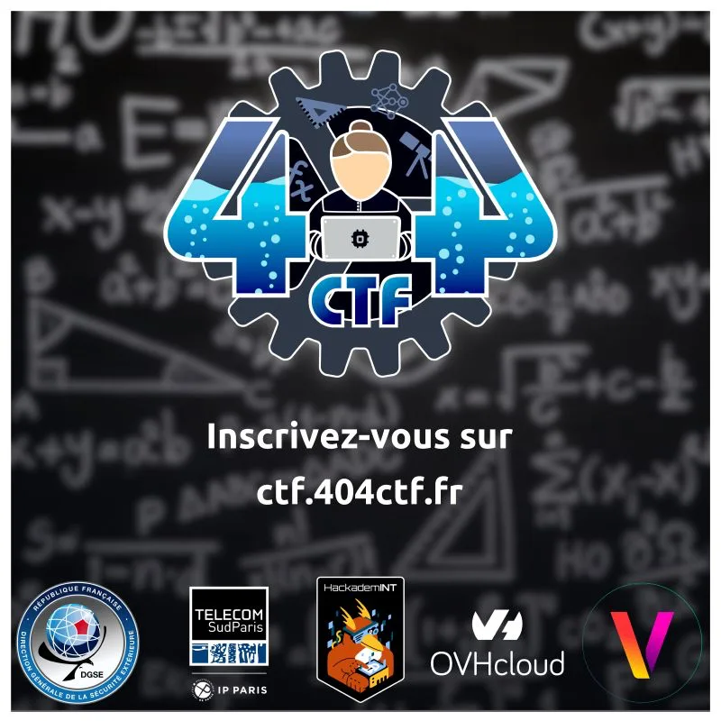

---
tags:
  - Osint
  - CTF
  - 404CTF
description: RETEX de ma participation au 404 CTF édition 2026
---

Comme toujours pour le 404CTF, je ne participe qu'à la catégorie "Renseignement en Sources Ouvertes", cette année, j'ai fait de même.
J'ai été plutôt impliqué lors de la première vague de challenges, mais pour la deuxième, je n'ai malheureusement pas eu le temps de m'y mettre activement.
Je vais quand même partager ici les RETEX de certains challenges que j'ai pu flag. Et certaines méthodes et pistes qui m'ont permis d'aller plutôt loin dans d'autres même si je ne les ai pas flag, comme le challenge [[Une aiguille dans une île-de-France]] ou [[Enfance gourmande]].

Les RETEX des challs que j'ai pu flag : 
- [[Chaud Devant]]
- [[Doctor Es Langues]]
- [[Canular savant 1]]
- [[Canular savant 2]]
- [[Moniseur C Decouverte]]
- [[C'etait cache]]
- [[Metro OSINT Dodo]]

Et ceux où j'avais de bonnes pistes, mais où je n'ai pas capitalisé :
- [[Une aiguille dans une ile-de-France]]
- [[Enfance gourmande]]

>[!info]
>J'ai perdu ma base de RETEX du 404, je vais donc devoir les refaire, je vais essayer de sortir au moins un RETEX de challenge par jours.