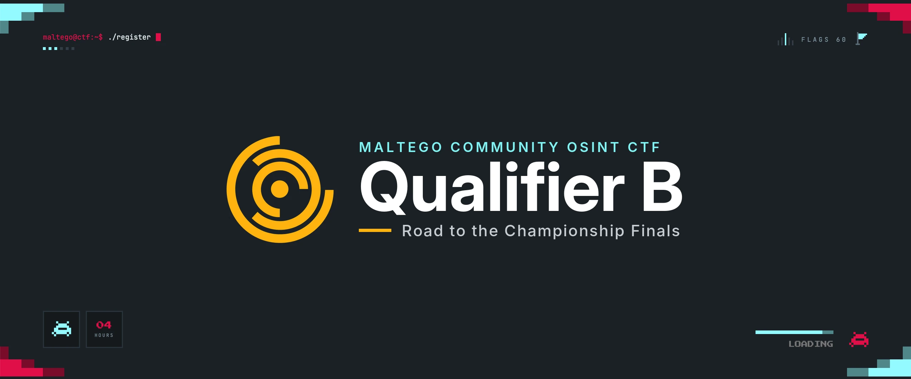

Le **Qualifier B** du *Maltego Community OSINT CTF Championship 2026-27* s'est déroulé en ligne le 13 novembre 2026. Organisé par Maltego Technologies, ce championnat se joue en trois temps : deux phases de qualification en ligne (le Qualifier A le 12 septembre 2026, puis le Qualifier B), et une finale hybride de 5 heures prévue en janvier 2027, réservée aux 10 meilleures équipes, autour d'une investigation en plusieurs phases.

Chaque qualifier prend la forme d'un CTF de **4 heures**, composé de **60 challenges** allant du niveau débutant à avancé. Certains s'enchaînaient, d'autres étaient complètement indépendants, et ils étaient répartis dans les catégories suivantes :
![[MQB_CAT.png]]

Particularité de ce championnat : le classement général additionne les scores des deux qualifiers. Une équipe qui ne participe qu'à une seule des deux phases n'a donc quasiment aucune chance d'entrer dans le top 10, même si elle a très bien performé sur la phase qu'elle a jouée.

Je n'ai malheureusement pas participé au Qualifier A, tout simplement parce que je ne savais pas qu'il existait. Pour le Qualifier B, j'ai donc rejoint Caxtiq dans l'équipe **Nothingspecial**, qui avait déjà joué la phase A.

![[MQB_EKIP.png]]

Malgré cette arrivée en cours de route, nous avons terminé **20ᵉ sur 217 équipes** au classement général (soit le top 10 %), avec **10 337 points** cumulés sur les deux phases. De mon côté, j'ai remporté **5 073 points** en ne jouant que le Qualifier B, soit près de la moitié du score total de l'équipe.

Globalement, je me suis bien amusé.

Je n'ai pas pu toucher à toutes les catégories en 4 heures, mais les challenges étaient intéressants et variés. Ce format court, qui tient un peu du « speedrun », est vraiment sympa : il faut aller vite, prioriser et accepter de laisser certains challenges de côté.

Mon seul regret concerne le classement cumulé : il récompense la régularité sur les deux phases, ce qui se comprend, mais il ferme quasiment la porte de la finale à ceux qui, comme moi, découvrent le championnat en cours de route.

L'année prochaine, j'essaierai donc de faire les deux phases, et idéalement avec une équipe aussi impliquée que moi, pour tenter d'aller chercher une place en finale.

![[70f10f7d-7a1a-467b-83b4-79e064a4af6a.png|300]]

***Les différentes parties du CTF :***
 · | · [[Geolocation]]
 · | · [[Threat Intelligence]]
 · | · [[Fraud]]
 · | · [[Physical Security]]
 · | · [[Chronolocation]]
 · | · [[Trust & Safety]]
 · | · [[Due Diligence]]
 · | · [[Maritime & Aviation]]
 · | · [[Dark Web]]
