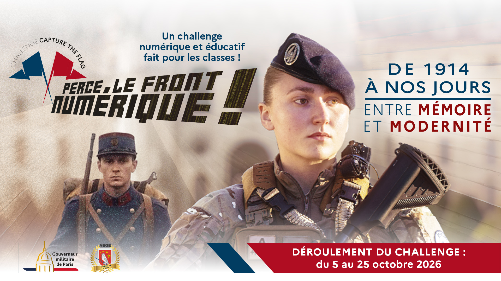

---
tags:
  - Osint
  - CTF
  - PerceLeFrontNumeriqueV2
order: 1
description: RETEX de ma participation au CTF Perce le Front Numérique V2
---

Le CTF **Perce le front numérique !**, deuxième édition, s'est déroulé du 5 octobre 2026 à 8h00 au 25 octobre 2026 à 18h00, entièrement en ligne sur une plateforme CTFd, en participation individuelle ou en équipe jusqu'à quatre personnes. Il est organisé par le Gouverneur militaire de Paris avec le Club OSINT et Veille de l'AEGE, le même club qui organise le Bleuet de France, avec le soutien de la Fédération Nationale André Maginot.

Le thème de cette édition retrace les évolutions de l'armée de Terre de 1914 à aujourd'hui, autour du renseignement, de la mémoire et de l'histoire militaire. Le CTF est structuré en une Learning Track, puis quatre tracks thématiques : Les monuments militaires français, La Section camouflage, Les femmes dans les armées, et un Track Bonus consacré au 14 Juillet. Contrairement à un CTF narratif classique, chaque track rassemble des challenges indépendants les uns des autres, sans fil conducteur ni suite réelle entre eux, et tous étaient accessibles dès le lancement.

Nous avons participé à trois sous la bannière DGSI (Direction Générale des Suppositions Improbables), avec Z3r0D4y_Gh05t et K@k@r0tt0 (K@k@r07), la même équipe qu'avec [[Opération Culot]].

![[PLFNV2_EKIP.png|500]]

Les histoires (vraies) abordées par les challenges étaient vraiment sympas, et j'ai appris beaucoup de choses : une bonne introduction à l'OSINT côté archives, au point de me perdre plusieurs fois à suivre des histoires adjacentes aux challenges plutôt que les challenges eux-mêmes.

Cependant, l'organisation m'a semblé un peu en retrait par rapport à ce qu'un évènement de cette ampleur peut proposer. Plusieurs indices m'ont donné l'impression que le CTF n'avait pas été suffisamment beta-testé avant son lancement : des formats de réponse trop évasifs, voire trompeurs, ont fait buter des flags qui auraient dû passer (par exemple `Honneur Courage et Fraternité` ou `Sur la route de la libération`), d'autres challenges demandaient carrément une réponse erronée (`Une dénomination plus technique`, `Merlinettes`), et certains ignoraient des réponses alternatives pourtant valables. Plus largement, j'ai eu le sentiment que certains challenges reposaient sur une seule source sans recoupement, ce qui laisse passer des erreurs et ouvre la porte à des rabbit holes qui n'auraient pas dû exister.

À cela s'ajoute l'absence de serveur Discord dédié, qui a beaucoup freiné les échanges avec le support : pas moyen de suivre en direct si un souci de flag était identifié et en cours de correction, ni de croiser rapidement son ressenti avec d'autres joueurs pour savoir si on était seul à bloquer sur un challenge. Sur un CTF de cette taille, ça s'est clairement fait sentir.

Malgré tout ça, nous avons réussi à boucler l'intégralité des challenges, et une fois ces soucis d'organisation mis de côté, ça restait une expérience sympa à vivre en équipe.

Je suis donc un peu déçu par la rigueur de l'organisation, m'attendant à quelque chose d'aussi léché que le Bleuet de France, mais ça m'a quand même fait découvrir des sources que je ne connaissais pas et fait réviser mes méthodes de recherche d'archives.

***Les différentes parties du CTF :***
 · | · `[[Learning Track]]`
 · | · `[[Les monuments militaires français]]`
 · | · `[[La Section camouflage]]`
 · | · `[[Les femmes dans les armées]]`
 · | · `[[Track Bonus - Le 14 Juillet]]`

> [!info] RETEX à venir
> Le CTF n'étant pas encore terminé pour tout le monde, les RETEX détaillés par track seront publiés une fois le délai clos pour l'ensemble des participants.
